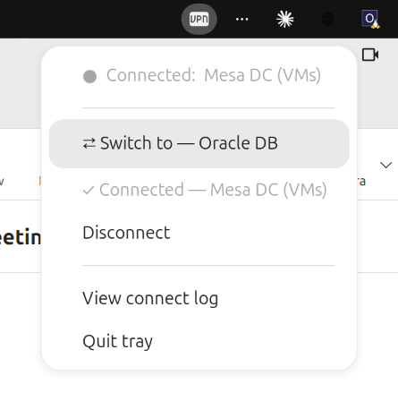

# gp-tray

A free, lightweight system-tray VPN indicator for **GlobalProtect** on Linux,
built on the open-source [`gpclient`](https://github.com/yuezk/GlobalProtect-openconnect).
It gives you the one thing the official client doesn't ship on Linux: a proper
tray applet with connect/disconnect, multi-portal switching, and desktop alerts.

It is a single Rust binary that reacts to systemd and kernel events — no
polling loop, no Python or GTK runtime — and a fork of
[DavidVeksler/gp-tray](https://github.com/DavidVeksler/gp-tray) reworked "the
Linux way". Packaged for Arch Linux on the
[AUR](https://aur.archlinux.org/packages/gp-tray).

 

<p align="center">
  
</p>

## Features

- **Live status** — Connected / Connecting / Disconnected with the active
  portal by name, each with its own green / amber / grey icon. The state comes
  from systemd's unit signals and netlink link events for `gp0`, so the icon
  changes the moment the tunnel does.
- **Multiple portals and gateways** — one tunnel at a time, switched with one
  click; gateways declared per portal appear in a submenu (*Auto (fastest)*
  included), and the tray remembers your last choice.
- **Desktop notifications** — connected, unexpected drop, connect failure
  (with the real error line), authentication cancelled, and timeouts.
- **No pkexec, no password prompts** — SAML runs unprivileged in your browser
  (`gpauth`); the tunnel is a systemd **system** unit that a shipped polkit
  rule lets active local users start/stop.
- **Survives restarts** — the tunnel is supervised by systemd, so it stays up
  when the tray restarts, and is torn down cleanly on suspend.

## Requirements

- [`gpclient` / `gpauth`](https://github.com/yuezk/GlobalProtect-openconnect#installation)
- polkit, which evaluates the shipped rule authorizing tunnel start/stop
  (`pkexec` itself is not used)
- a StatusNotifierItem-capable desktop: KDE Plasma, XFCE, Cinnamon, MATE and
  friends work out of the box; GNOME Shell needs the
  [AppIndicator extension](https://extensions.gnome.org/extension/615/appindicator-support/)

Nothing else at runtime. For a build from source you also need Rust 1.85 or
newer (edition 2024) with `cargo`. Full list, and what each piece is for:
[docs/dependencies.md](docs/dependencies.md).

## Install

### Arch Linux (AUR)

```bash
yay -S gp-tray   # or: paru -S gp-tray
systemctl --user daemon-reload
systemctl --user enable --now gp-tray.service
```

### From source

```bash
git clone https://github.com/Its-Alex/gp-tray.git
cd gp-tray
make install-user               # builds the tray (cargo) and installs it to ~/.local
sudo make install-privileged    # tunnel unit, root helper, polkit rule, tmpfiles
systemctl --user daemon-reload
systemctl --user enable --now gp-tray.service
```

For a system-wide install instead, build as yourself and then install:

```bash
cargo build --release --locked
sudo make install PREFIX=/usr
```

### First install only

The handoff directory has to be created once and systemd has to read the new
system unit:

```bash
sudo systemd-tmpfiles --create gp-tray.conf
sudo systemctl daemon-reload
```

## Configuration

Portals live in `$XDG_CONFIG_HOME/gp-tray/portals.conf`
(`~/.config/gp-tray/portals.conf`), one per line as
`Friendly Name = hostname`, with optional gateways after `|`:

```ini
Work VPN      = portal.example.com | US-East, EU-Frankfurt
Secondary VPN = vpn2.example.com
```

A commented template is created on first start. Lines starting with `#` are
ignored, and `GP_PORTAL` injects an extra portal at runtime. Gateway names must
match what the portal reports; portals without a gateway list connect with
`--auto-gateway`. Restart the service after editing:

```bash
systemctl --user restart gp-tray.service
```

## How it works

```
you click Connect
  └─ gpauth --browser default <portal>        (your user, browser SAML)
       └─ cookie → /run/gp-tray/cookie        (0600, single-use)
            └─ StartUnit over D-Bus → gp-tray-tunnel@<portal>.service
                 └─ gpclient connect --cookie-on-stdin   (root, supervised
                    by systemd, cookie via systemd credentials, then deleted)
```

Only the tunnel runs as root, under a static unit whose command line is fixed
on disk; the polkit rule authorizes exactly that unit's start/stop/restart,
the same trust model NetworkManager uses. Full details, diagrams included:
[docs/architecture.md](docs/architecture.md).

Tray logs: `journalctl --user -u gp-tray.service`. Tunnel logs:
`journalctl -u 'gp-tray-tunnel@*'`. The connect log (with `gpauth` output) is
`~/.cache/gp-tray/connect.log`, reachable from the tray menu; `gp-tray status
--watch` prints every state transition as the tray sees it.

## Troubleshooting

**`certificate verify failed` / `unable to get local issuer certificate`.**
Your portal serves a valid certificate but omits an intermediate CA. Fetch the
intermediate named in the leaf certificate's *CA Issuers* URL, then trust it:

```bash
sudo cp intermediate.crt /usr/local/share/ca-certificates/
sudo update-ca-certificates
```

**A connect fails with a permissions error** (`Access denied`,
`Interactive authentication required`). The polkit rule isn't installed, or
polkit wasn't reloaded after a manual install. Check
`/usr/share/polkit-1/rules.d/50-gp-tray.rules` (package) or
`/etc/polkit-1/rules.d/` (source install).

**Connect fails with `/run/gp-tray missing`.** The tmpfiles entry hasn't been
applied: `sudo systemd-tmpfiles create gp-tray.conf`.

**The icon stays on "Connecting" while the VPN is up.** The tray isn't
receiving systemd's unit signals — restart it
(`systemctl --user restart gp-tray.service`), then check
`gp-tray status --watch` to see whether the engine or the UI is at fault.

## Changes from upstream

- **Rust instead of Python and GTK** — one compiled binary, no interpreter
  start-up, no PyGObject/GTK/AppIndicator runtime dependencies.
- **Event-driven instead of a 3 second poll** — systemd's `PropertiesChanged`
  / `UnitNew` signals plus `RTNLGRP_LINK` events for `gp0`; version 2.0.0 is
  this rewrite.
- **No pkexec, no password prompts** — upstream ran `pkexec gpclient
  connect/disconnect`; here SAML is unprivileged and the tunnel is a systemd
  unit authorized by a polkit rule.
- **systemd user service** instead of an ad-hoc `X-GNOME-Autostart` entry, and
  a tunnel that survives tray restarts and logs to the journal.
- **XDG Base Directory compliance** — config in `$XDG_CONFIG_HOME/gp-tray/`,
  logs and state in `$XDG_CACHE_HOME/gp-tray/`.
- **Distinct per-state icons** shipped and installed into the hicolor theme,
  and **proper packaging** — a `Makefile` with `DESTDIR`/`PREFIX`, the
  canonical [PKGBUILD](packaging/arch/PKGBUILD) in-tree, an
  [AUR package](https://aur.archlinux.org/packages/gp-tray), and a
  [release pipeline](RELEASING.md) that publishes each tag.

## Releasing

See [RELEASING.md](RELEASING.md) for the tag + AUR process.

## License

MIT © David Veksler (original author). Fork maintained by
[Its-Alex](https://github.com/Its-Alex). Not affiliated with Palo Alto Networks
or GlobalProtect.

This codebase is vibecoded: written by Claude (an Anthropic model) working
under human direction, review and testing.
